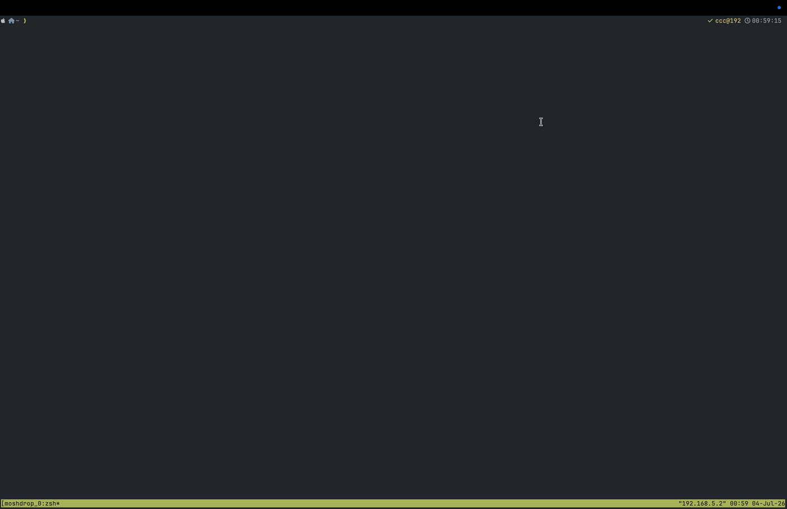

# moshdrop

**Keep mosh. Just drop files.**

A transparent [mosh](https://mosh.org) wrapper for macOS: drag any file into your terminal window and it uploads to the remote machine. Quick uploads insert a ready-to-use remote path; late uploads wait for explicit copying so they do not land in a pane you switched to. Everything else passes through byte-for-byte.



*Real time ÷ 2.5 — take a screenshot, drag the floating thumbnail into a mosh session, the remote path appears; Claude Code on the remote box reads the actual image.*

## Why

mosh doesn't carry your bytes end-to-end — it syncs *screen state*. That's what makes it survive bad Wi-Fi, and it's also why every trick that smuggles files through the terminal (zmodem/lrzsz, trzsz, iTerm2 ⌥-drag, kitty transfer) dies at the mosh boundary. In-band support has been requested for years ([zmodem](https://github.com/mobile-shell/mosh/issues/1184), [escape-sequence pass-through](https://github.com/mobile-shell/mosh/issues/1135)) with no path forward inside the protocol.

Meanwhile, if you run **Claude Code / Codex or any AI CLI on a remote box over mosh + tmux**, you constantly want to feed it local screenshots. moshdrop makes that a single drag.

Unlike [tssh](https://github.com/trzsz/trzsz-ssh) (which replaces mosh entirely), moshdrop keeps your battle-tested mosh exactly as it is: it's a local pty proxy that ferries files over a parallel ssh channel, reusing your existing `~/.ssh/config` and keys. Nothing to install on the remote.

## Install

```sh
brew install rrrrrrrrrricoxi/tap/moshdrop        # recommended
```

Or grab a binary from [Releases](../../releases) (macOS arm64/amd64), or `go install github.com/rrrrrrrrrricoxi/moshdrop@latest`.

> Downloaded binaries (not via brew) are unsigned; first run: right-click → Open, or `xattr -d com.apple.quarantine moshdrop`.

Release archives include an optional `MoshdropNotifier.app`; keep it beside the
executable. Homebrew packaging puts it in `libexec`. `go install` alone does not
build this helper, but local recovery still works. The helper requires macOS 13+
and is ad-hoc signed, **not notarized**; Gatekeeper and permission behavior need
manual release acceptance. No install hook bypasses macOS security or requests
notification permission.

## Use

```sh
moshdrop myhost -- tmux new -A -s main    # exactly like mosh — all args pass through
alias mosh=moshdrop                        # or take over the mosh command entirely
```

Then **drag any file into the terminal window** (Finder files, multi-select, even the macOS screenshot floating thumbnail). If delivery is ready before the default **five-second cutoff**, the remote path appears at your cursor as a paste, so TUI apps like Claude Code treat it like a real attachment. The cutoff starts when the drop is accepted, including queue time.

Later uploads finish without inserting input or changing the clipboard. Choose
**Copy path** on the completion notification, then paste in the intended pane.
The action may require hovering over or expanding the macOS notification. If the
helper or alerts are unavailable, recover with `moshdrop pending` on the local Mac.
Quick delivery is still time-based, not pane tracking; it can follow a pane switch
within five seconds. Set `auto_insert_seconds = 0` for explicit copying every time.

**Copied an image instead of a file?** (right-click → *Copy Image* in a browser, or a screenshot sitting in the clipboard): press **Ctrl+V** in the session — the same key Claude Code uses for image paste locally. moshdrop uploads the clipboard image and uses the same quick/late delivery rule. Late uploads do not automatically replace your clipboard image. No image in the clipboard → the keystroke passes through unchanged.

```sh
moshdrop paste myhost     # upload the clipboard image (Cmd+Ctrl+Shift+4 style);
                          # the remote path is copied back to your clipboard — just Cmd+V
moshdrop doctor myhost    # end-to-end health check: connectivity, remote dir, real probe upload
moshdrop pending          # list held results locally, also after the session exits
moshdrop pending --copy <id>  # explicitly copy the selected upload's grouped paths
moshdrop notifications setup # optional: request macOS alert permission for Copy path
```

Normal uploads never request notification permission. Dismissal and clicking the
notification body do not copy. Use your terminal's normal Paste action (commonly
Cmd+V); Ctrl+V remains the image-upload shortcut, not a pending-delivery shortcut.
Held metadata is private and retained for up to seven days / the newest 100 results.
See [late-upload delivery](docs/late-upload-delivery.md) for limits and packaging.

## Config (optional)

`~/.moshdrop/config` — plain `key = value`:

```ini
ttl_days = 7          # auto-clean remote files older than N days (0 = keep forever)
intercept = on        # off = pure passthrough, drag-upload disabled
lang = en             # en | zh
remote_dir = .moshdrop
max_intercept_mb = 50 # skip auto-upload above this size; paste local path + notice instead (0 = no limit)
paste_key = on        # lone Ctrl+V uploads the clipboard image in-session (off = the key is never touched)
auto_insert_seconds = 5 # automatic insertion before this cutoff; includes queue/probe time (0 = explicit copy only)

host.workbox.remote_dir = drops    # per-host overrides
host.workbox.intercept = off
```

## How it works

moshdrop sits between your terminal and mosh, like a doorman:

```
you ──▶ moshdrop ──▶ mosh ──▶ remote
```

- **Almost all the time it does nothing.** Keystrokes pass straight through, untouched and in order. (One deliberate exception: a *lone* ESC press is held ~50 ms to tell it apart from a paste marker — the same disambiguation trick as vim's `ttimeoutlen`. Complete escape sequences like arrow keys are not delayed.)
- **When you drag a file in**, your terminal actually just "types" the file's local path as a paste. moshdrop recognizes path-shaped pastes, double-checks every path is a real file on your local disk, quietly uploads them over a second ssh connection, and either pastes the *remote* path before the cutoff or holds it for explicit copying afterward.
- **Files over `max_intercept_mb` (default 50 MB) are not uploaded** — a notice tells you to `scp` them yourself. Quick drag candidates replay the local path; already-late candidates do not insert input. A stray huge drag never ties up your session over a weak link.
- **A lone Ctrl+V with an image in the local clipboard** (`paste_key = on`, the default) uploads that image the same way — Ctrl+V is Claude Code's paste-image key, so the local muscle memory carries over. No image → the key passes through after a quick clipboard check (~0.1 s). If the check outlasts its deadline and then finds nothing, the keystroke is *not* forwarded late — the remote app would read its own machine's clipboard and quietly grab the wrong image — you get a notification instead.
- **If an upload fails** — no network, remote disk full — a quick drag failure replays the original paste with a notification. Late failures do not insert anything into the active pane and are recorded in local recovery history. Clipboard-image failures never replay input. Your typing is never blocked by an upload. `~/.moshdrop/events.log` keeps a one-line record per drop.
- **Files don't land half-written.** Uploads go to a hidden temp name, the byte count is checked (transport integrity is ssh's job), and only then is the file atomically linked to its real name. A connection dying mid-transfer leaves at worst a hidden temp file, swept on the next connect.

## Resource footprint (measured, Apple Silicon)

These existing measurements cover the Go wrapper, not the new helper's transient
startup/notification work. The helper runs on demand; no persistent service is added.

| | |
|---|---|
| CPU when idle | **0.0%** — fully event-driven, no polling |
| CPU at 2 KB/s sustained input (~200× human typing) | ~0.4% |
| Memory | ~5 MB |
| Added keystroke latency vs bare mosh | ~0.1 ms (within measurement noise; lone-ESC exception above) |
| Network when idle | **zero** — the ssh side channel closes itself 2 min after last use |
| Network during transfers | file size + a few % ssh overhead, over one reused connection |
| Keepalive | none of moshdrop's own once the side channel closes; while the channel is open (transfers + the 2-min linger) it pings every 15 s so a dead link is detected within ~1 min instead of hanging |

mosh's own tiny UDP heartbeats are unchanged — moshdrop adds nothing to them.

## Also wraps plain ssh, et, …

moshdrop is a generic pty wrapper; mosh is just the default. Anything that talks to a terminal works:

```sh
MOSHDROP_CMD=ssh moshdrop myhost              # drag-drop for plain ssh
MOSHDROP_CMD=et  moshdrop myhost              # Eternal Terminal
```

If the ssh target can't be derived from the wrapped command's arguments, set `MOSHDROP_TARGET=host` explicitly (the `paste` subcommand honors it too).

## FAQ

**Is my typing inspected?** Byte-at-a-time typing is never touched, with one keyed exception you control: a *lone* `Ctrl+V` triggers a local clipboard check (see the next question; `paste_key = off` removes even that). Otherwise input is only examined when it arrives as a paste-like burst, and only swallowed when *every* token is an absolute path to an existing local regular file — which in practice means drags. Note the flip side: manually pasting text that happens to be exactly such a path is treated identically (the file uploads and the remote path is pasted). If that's ever not what you want, quote the path or set `intercept = off`.

**I use Ctrl+V in vim (visual block) / shell quoted-insert / tmux copy-mode.** While an image sits in your local clipboard, a lone Ctrl+V is claimed by moshdrop instead of reaching the remote app; with no image it passes through with ~0.1 s added latency. If Ctrl+V is part of your remote workflow, set `paste_key = off` — the key is then never even checked.

**How does it detect a drag?** Terminals deliver a drop as a (usually [bracketed](https://en.wikipedia.org/wiki/Bracketed-paste)) paste of the file's path. When the remote app hasn't enabled bracketed paste, a stricter fallback heuristic catches typical drops; if nothing matches, the path text simply passes through. Recognized candidates replay on quick failure; late candidates are not inserted.

**What does the upload channel need?** It's non-interactive (`BatchMode`): if `ssh yourhost true` works without typing anything (keys/agent), you're set. Password or interactive-2FA auth will make drops fail (mosh itself still works). `moshdrop doctor yourhost` checks this end-to-end.

**Exit codes?** Same as mosh for normal exits (mosh itself never propagates remote command exit codes — protocol limitation). If mosh dies from a signal, moshdrop exits 1.

**Linux?** Remote side: any POSIX-ish `sh` + coreutils (`find -delete` needed for auto-cleanup; without it files just accumulate). Local side is macOS-only for now — PRs welcome.

## License

MIT
